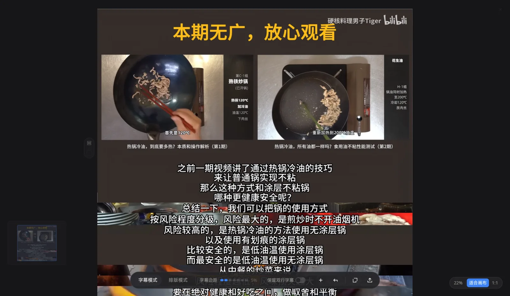

# 省流图创造机（GistPic Creator）

把视频截图里的字幕裁出来，从上到下拼成一张长图；也可以把几张图片排成一张长图。支持 Linux、macOS、Windows。



字幕模式下的界面：中间是成品，底部胶囊切模式和调边距，右下角是显示比例。

## 效果

| 字幕模式 | 排版模式 |
| :---: | :---: |
|  |  |

## 功能

- 字幕模式：拖入截图，自动找字幕、裁掉多余画面，按顺序拼成长图；识别不准时拖上下边线手动框选，可以套用到选中的图片
- 排版模式：图片只缩放不裁剪，可选横排、竖排、点一下换一种拼法的循环排版（行业叫 Shuffle Layout）
- 自动区分弹幕和字幕；多行字幕默认保留第一行，可以切换成双行
- 两种模式共用一份图片列表，间距、排序、多选都在画布上直接改
- 撤销、重做、缩放，导出 PNG 或复制到剪贴板
- 深色界面，窗口大小和选项自动保存，支持中文和英文

## 使用

截图后按 `Ctrl/Cmd + V` 粘贴，或把图片拖进窗口；识别不对就拖上下边线手动框选；底部胶囊切模式、调边距或比例；点复制或导出保存。复制默认是小图（最长边 2000 像素），在复制按钮上点右键可切到原图，按钮中间的「小 / s」就是小图模式。

完整的快捷键、手势、右键菜单和托盘说明见 [docs/gestures.md](docs/gestures.md)。

## 下载与构建

安装包在 [Releases](https://github.com/wastee/gistpic-creator/releases) 页面。从源码构建需要 Rust 1.90 或更新版本：

```bash
cargo build --release
```

各平台依赖和打包脚本见 [docs/build.md](docs/build.md)，测试和目录结构等开发说明见 [docs/development.md](docs/development.md)。

## 许可

本项目代码使用 GNU General Public License v3.0（GPL-3.0），全文见 [LICENSE](LICENSE)。

内嵌的字幕检测模型来自 `robertknight/ocrs-models`，使用 CC-BY-SA-4.0 许可，详见 [THIRD_PARTY_NOTICES.md](THIRD_PARTY_NOTICES.md)。GPL-3.0 与 CC-BY-SA-4.0 兼容，两部分各自的许可条件都要遵守。
