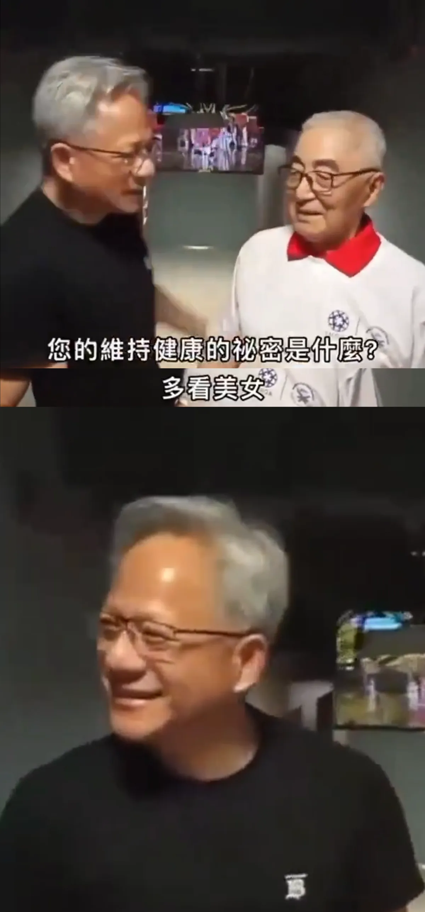

# 省流图创造机

把视频截图里的字幕裁出来，一张张拼成竖长图；也能把几张图排成一张整齐的版面。

界面用 [GPUI](https://gpui.rs) 写的，Linux、macOS、Windows 都能用，不联网。

## 看看效果

**字幕模式**：把一段视频的几个画面截下来，自动认出每张里的字幕，裁掉多余部分拼成一张长图。第一张保留画面主体，后面每张只留字幕那一条。



**排版模式**：几张图等比例排成一张，不裁剪、不拉伸、不变形。


## 它能做什么

**字幕模式**

- 粘贴或拖进多张截图，自动找字幕，优先看画面下半部分
- 第一张保留画面主体，后面每张只留字幕那一条，上下各留一点呼吸空间
- 认不准就拖一下上下那条线，手动框住要保留的部分，能只改一张也能套用到全部
- 弹幕不会被当成字幕
- 多行字幕默认只留第一行，需要双行在右键卡片里打开

**排版模式**

- 不裁字幕，按图片宽高自动分组，等比例缩放排整齐
- 选 16:9、9:16、4:3、1:1，也可以横排、竖排
- 不跑字幕识别，图拖进来立刻就能看到

**两边都有**

- 整个窗口就是一张画板，没有工具栏、没有侧边栏
- 识别在后台跑，拖图、排序、调间距都不用等
- 底部一条胶囊：切模式、调字幕边距或排版比例、添加、撤销、复制、导出
- 复制直接进剪贴板，或者导出 PNG 文件
- 跟随系统浅色 / 深色外观，界面有简体中文和英文
- 关窗口默认收到托盘继续运行，点托盘图标叫回来

## 怎么用

1. **加图**：截图后按 `Ctrl+V`（Mac 是 `Cmd+V`），或者把图片拖进窗口，或者右键选「打开图片」
2. **调切割**：鼠标移到图上会浮出被裁掉的区域，按住任意一条边拖动。上下两条线靠近字幕、整张画面时会自动吸附
3. **调间距**：按住作品左边竖条的上半部分上下拖，0 到 100 像素；点下面的圆点换缝隙颜色，纯白、炭黑、暖灰三选一
4. **拿走成品**：点底部胶囊上的「复制」放进剪贴板，或点「导出」存成文件

## 安装

需要 Rust 1.90 或更新版本。

```bash
cargo build --release
```

**Linux** 还要装运行库，并且显卡要支持 Vulkan：

```bash
# Arch
sudo pacman -S vulkan-icd-loader libxkbcommon libxkbcommon-x11 wayland libxcb

# Debian / Ubuntu
sudo apt install libvulkan1 libxkbcommon0 libxkbcommon-x11-0 libwayland-client0 libxcb1
```

GNOME 上托盘图标要装 AppIndicator 扩展才会显示，具体命令见 [docs/build.md](docs/build.md)。

**macOS** 先装 Xcode 命令行工具，再跑打包脚本：

```bash
xcode-select --install
./scripts/build-macos.sh
```

**Windows** 需要 MSVC 工具链：装 Visual Studio 生成工具，勾选「使用 C++ 的桌面开发」，然后：

```powershell
./scripts/build-windows.ps1
```

每个平台都能打成便携包，Linux 还支持打成 Arch 安装包，命令和产物见 [docs/build.md](docs/build.md)。

## 快捷键

| 操作 | 快捷键 |
| --- | --- |
| 粘贴图片 | `Ctrl/Cmd + V` |
| 打开图片 | `Ctrl/Cmd + O` |
| 导出 | `Ctrl/Cmd + E` |
| 复制图片到剪贴板 | `Ctrl/Cmd + C` |
| 撤销 / 重做 | `Ctrl/Cmd + Z` / `Ctrl/Cmd + Shift + Z` |
| 全选 | `Ctrl/Cmd + A` |
| 删除选中的图片 | `Delete` |
| 缩放画布 | `Ctrl/Cmd + 滚轮`，或 `Ctrl/Cmd + + / - / 0` |
| 退出程序 | `Ctrl/Cmd + Q` |

鼠标手势、右键菜单、托盘行为都在 [docs/gestures.md](docs/gestures.md)。

## 更多文档

- [构建与打包](docs/build.md)：各平台细节、桌面图标安装、Arch 安装包、便携包
- [界面手势](docs/gestures.md)：完整手势表、右键菜单、托盘和关闭按钮
- [开发说明](docs/development.md)：目录结构、测试覆盖、启动测量、日志

## 许可

本项目代码使用 GNU General Public License v3.0（GPL-3.0）许可证，全文见 [LICENSE](LICENSE)。

内嵌的字幕检测模型来自 `robertknight/ocrs-models`，使用 CC-BY-SA-4.0 许可，详见 [THIRD_PARTY_NOTICES.md](THIRD_PARTY_NOTICES.md)。GPL-3.0 与 CC-BY-SA-4.0 兼容，两部分各自的许可条件都要遵守。
